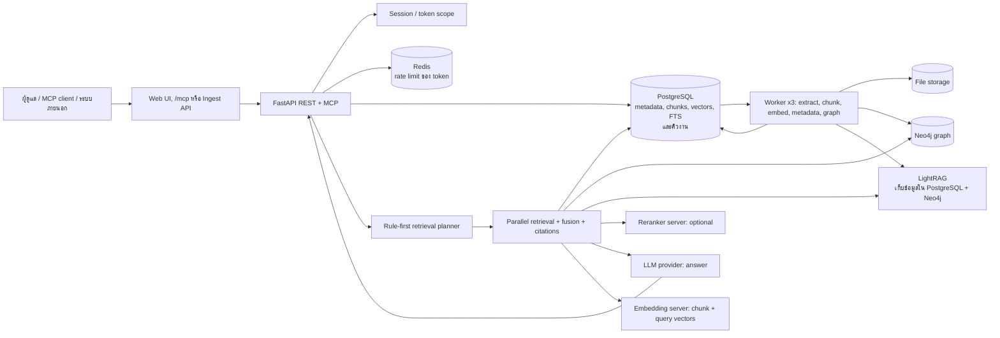

# Softnix Knowledge Intelligence

แพลตฟอร์มจัดการเอกสารและค้นคืนความรู้แบบมีหลักฐานอ้างอิง (citation) สำหรับผู้ดูแลระบบและ MCP/AI agent

## การติดตั้ง

### สิ่งที่ต้องมี

- Docker พร้อม Compose v2 (Docker Desktop บน macOS หรือ Windows)
- repository [Anydoc-ocr](https://github.com/rujirapongsn2/Anydoc-ocr) วางไว้ข้างโฟลเดอร์นี้ (`../Anydoc-ocr`) เพราะ image ของ api และ worker build ตัวแปลงเอกสารจาก repository นั้น ถ้าวางไว้ที่อื่น ให้ตั้ง `ANYDOC_DIR`
- `llama-server` ของ [llama.cpp](https://github.com/ggml-org/llama.cpp) สำหรับ embedding server บน macOS ติดตั้งด้วย `brew install llama.cpp`
- API key ของผู้ให้บริการ LLM ที่รองรับ OpenAI API เช่น OpenRouter หรือ OpenAI

### 1. ดาวน์โหลด source

```bash
git clone https://github.com/rujirapongsn2/Softnix_Knowledge_Intelligence.git
git clone https://github.com/rujirapongsn2/Anydoc-ocr.git
cd Softnix_Knowledge_Intelligence
```

### 2. เปิด embedding server

embedding server สร้าง vector ของเอกสารและคำถาม ถ้าไม่เปิด การค้นหาแบบ vector และการ index ของ LightRAG จะใช้ไม่ได้

```bash
llama-server -hf ggml-org/embeddinggemma-2-GGUF:BF16 --no-mmproj --embeddings \
  --host 0.0.0.0 --port 8090 -ngl 99 -c 32768 -b 8192 -ub 8192 --parallel 4 --api-key <embedding-key>
```

ครั้งแรกจะดาวน์โหลดโมเดลก่อน วิธีให้รันตลอดด้วย launchd และวิธีทดสอบอยู่ที่ [deploy/embedding-server](deploy/embedding-server/README.md)

ถ้าต้องการ reranker (ไม่บังคับ แต่ช่วยให้ผลค้นหาอันดับแรกตรงขึ้น) ให้เปิด server ตาม [deploy/reranker-server](deploy/reranker-server/README.md)

### 3. ตั้งค่า `.env`

```bash
cp .env.example .env
openssl rand -hex 32   # รันหนึ่งครั้งต่อค่า secret แต่ละตัว
```

ค่าที่ต้องแก้ก่อนเริ่มระบบ:

| ตัวแปร | ค่า |
|---|---|
| `APP_SECRET_KEY`, `TOKEN_HASH_SECRET`, `LIGHTRAG_API_KEY` | ค่าสุ่มที่ไม่ซ้ำกัน |
| `INITIAL_ADMIN_PASSWORD`, `NEO4J_PASSWORD` | รหัสผ่านใหม่ |
| `LLM_API_KEY` | key ของผู้ให้บริการ LLM ถ้าไม่ได้ใช้ OpenRouter ให้แก้ `LLM_BASE_URL` และ `LLM_MODEL` ด้วย ตั้ง `LLM_ANSWER_MODEL` ถ้าต้องการให้คำตอบใช้โมเดลอื่น (ค่าว่างใช้ `LLM_MODEL`) ดูตัวอย่างใน `.env.example` |
| `EMBEDDING_API_KEY` | key เดียวกับที่ใส่ใน `--api-key` ของขั้นที่ 2 |
| `SOFTNIX_OCR_BASE_URL`, `SOFTNIX_OCR_TOKEN` | ถ้ายังไม่มี OCR server ให้ปล่อย `SOFTNIX_OCR_TOKEN=` ว่าง ค่าตัวอย่างใน `.env.example` ชี้ไปที่ host ที่ไม่มีอยู่จริง ถ้าปล่อยไว้ `/ready` จะตอบ 503 และ api จะไม่ขึ้นเป็น healthy |
| `RERANKER_ENABLED`, `RERANK_*` | ตั้งเมื่อเปิด reranker แล้วเท่านั้น |

- อย่า commit ไฟล์ `.env`
- บน Linux ไม่มี `host.docker.internal` ให้อัตโนมัติ ให้ใช้ IP ของ host ใน `EMBEDDING_BASE_URL` แทน หรือเพิ่ม `extra_hosts` ตาม [deploy/embedding-server](deploy/embedding-server/README.md)

### 4. build และเริ่มระบบ

```bash
docker compose up -d --build
```

การ build ครั้งแรกใช้เวลาหลายนาที เพราะต้อง compile ตัวแปลงเอกสาร (Rust) Compose จะเริ่ม service ตามลำดับนี้:

1. `postgres`, `redis` และ `neo4j`
2. `migrate` สร้างหรือปรับ schema ฐานข้อมูล แล้วจบ
3. `lightrag`, `api`, `worker` (3 replicas) และ `web`

| URL | ใช้ทำอะไร |
|---|---|
| `http://localhost:8081` | Web UI (ปรับด้วย `WEB_PORT`) |
| `http://localhost:8001` | REST API และ `/mcp` (ปรับด้วย `API_PORT`) |

### 5. ตรวจสถานะหลังติดตั้ง

```bash
bash deploy/check_services.sh
```

script ตรวจทุกอย่างที่ระบบต้องใช้ โดยไม่แสดง key หรือรหัสผ่าน และจบด้วย exit code ที่ไม่ใช่ 0 เมื่อมีข้อที่จำเป็นไม่ผ่าน

| กลุ่ม | สิ่งที่ตรวจ | ถ้าไม่ผ่าน |
|---|---|---|
| containers | `api`, `worker`, `web`, `postgres`, `redis`, `neo4j` และ `lightrag` กำลังรัน และ `migrate` จบด้วย exit code 0 | `docker compose logs <service>` |
| http | `GET /health` ตอบ 200 | api ยังไม่ขึ้น ดู `docker compose logs api` |
| | `GET /ready` ตอบ `ready` ทุก dependency ได้แก่ database, redis, neo4j, lightrag, embeddings และ ocr_chain (ocr_chain ตรวจเมื่อตั้ง `SOFTNIX_OCR_TOKEN` แล้ว) embeddings อาจเป็น `slow` ระหว่างนำเข้าชุดใหญ่ ซึ่งไม่นับว่าล้ม | คำตอบ 503 ระบุชื่อ dependency ที่ใช้ไม่ได้ใน `details` |
| | Web UI ตอบ 200 | `docker compose logs web` |
| providers | LLM ตอบ และมีโมเดลตาม `LLM_MODEL` (และ `LLM_ANSWER_MODEL` ถ้าตั้งไว้) | ตรวจ `LLM_API_KEY`, `LLM_BASE_URL` และชื่อโมเดล |
| | embedding server สร้าง vector ได้ | ตรวจว่า `llama-server` ยังรันอยู่ และ `EMBEDDING_API_KEY` ตรงกับ `--api-key` |
| | reranker เรียงผลได้ถูกต้อง (ตรวจเฉพาะเมื่อ `RERANKER_ENABLED=true`) | ดู [deploy/reranker-server](deploy/reranker-server/README.md) |
| | เครดิต LLM คงเหลือ (เฉพาะ OpenRouter) ขึ้น `warn` เมื่อต่ำกว่า `LLM_CREDIT_WARNING_USD` (ค่าเริ่มต้น $20) | เติมเครดิตก่อนนำเข้าชุดใหญ่ ถ้าหมด งานจะรอในคิวแล้วทำต่อเอง |

ผลที่ถูกต้องจะมีลักษณะดังนี้:

```text
containers
  ok    api running (1)
  ok    worker running (3)
  ...
  ok    migrate finished
http
  ok    api http://127.0.0.1:8001/health
  ok    api /ready: database ready, redis ready, neo4j ready, lightrag ready, ocr_chain ready, embeddings ready
  ok    web http://127.0.0.1:8081
providers (checked from inside the api container)
  ok    llm anthropic/claude-sonnet-5.5 (openrouter)
  ok    embeddings embeddinggemma-2 at host.docker.internal:8090
  ok    reranker bge-reranker-v2-m3

all required checks passed
```

ตรวจทีละส่วนด้วยมือได้ดังนี้:

```bash
docker compose ps -a                     # migrate ต้อง Exited (0), api/web/postgres/redis/lightrag ต้อง healthy
curl -s http://localhost:8001/health     # {"status":"healthy"}
curl -s http://localhost:8001/ready      # {"status":"ready","dependencies":{...}}
```

หลังเข้าสู่ระบบแล้ว หน้า **สถานะระบบ** (System Status) แสดงสถานะเดียวกันพร้อมคิวงาน `GET /api/v1/system/dashboard` ให้ข้อมูลเดียวกันในรูป JSON ได้แก่ จำนวนงานในคิว (`ingest_metrics.in_queue_count`), เอกสารที่ล้ม และผู้ให้บริการที่ถูกพักเพราะเครดิตหมดหรือ key ใช้ไม่ได้ (`services.provider_holds`)

### 6. ทดลองใช้งาน

1. เข้าสู่ระบบที่ Web UI ด้วย `INITIAL_ADMIN_USERNAME` และ `INITIAL_ADMIN_PASSWORD` แล้วเปลี่ยนรหัสผ่านทันที
2. สร้าง Knowledge Base แล้วกดเปิดใช้งาน
3. อัปโหลดเอกสารหนึ่งไฟล์ รอจนสถานะเป็น `completed` แล้วถามคำถามใน Query Playground

ระบบสร้างผู้ดูแลเริ่มต้นเฉพาะตอนที่ยังไม่มีบัญชีใดเลย ถ้าแก้ค่าใน `.env` ภายหลัง รหัสผ่านเดิมจะไม่ถูกรีเซ็ต

การติดตั้งแบบ production (HTTPS, restart policy, พอร์ตที่ห้ามเปิด) และการ migrate ดูที่ [Deployment](docs/DEPLOYMENT.md)

## ภาพรวมการทำงาน



คิวงานอยู่ใน PostgreSQL ไฟล์ที่ได้ `202` แล้วจะไม่หาย แม้ api หรือ worker จะ restart งานของ worker ที่หยุดกลางคันจะถูกคืนเข้าคิว ถ้าเครดิตของผู้ให้บริการ AI หมด งานจะรอในคิว แล้วทำต่อเองหลังเติมเครดิต

ดูไดอะแกรมและขอบเขตข้อมูลฉบับเต็มที่ [High-level Data Flow](docs/DATA_FLOW.md) และรายละเอียดส่วนประกอบที่ [Architecture](docs/ARCHITECTURE.md)

## การนำเข้าเอกสาร

Web/API รองรับ PDF, DOCX, PPTX, XLSX/XLS, TXT, Markdown, HTML, CSV และ JSON ตามขนาด `MAX_FILE_SIZE_MB` ค่าเริ่มต้น 100 MB

1. API ตรวจสิทธิ์, MIME/type, ขนาด และ SHA-256 กันไฟล์ซ้ำ แล้วเก็บไฟล์ต้นฉบับนอก web root
2. Worker แปลงเป็น Markdown ด้วย MarkItDown, normalize, แบ่ง chunk และสร้าง embedding
3. เก็บ metadata, chunk, vector, full-text และ provenance ใน PostgreSQL พร้อมฉาย graph ไป Neo4j และ sync ดัชนี LightRAG
4. PDF สแกนที่ไม่มี text layer จะเป็น `OCR_REQUIRED` หากไม่ได้ตั้งค่า OCR ภายนอก

เอกสารสามารถระบุ `published_at` (`YYYY-MM-DD`) ตอนอัปโหลดหรือแก้ไขภายหลังได้ วันที่นี้ใช้กรองข่าวตามเดือน/ปี และเอกสารที่ไม่มีวันที่จะไม่ผ่าน query ที่มี date filter

### เติม custom metadata อัตโนมัติ

Document Type สามารถกำหนดแต่ละ field ให้ “อ่านจากเอกสาร” ได้ อัปโหลดในหน้าเดียวแล้วระบบเติมข้อมูลเบื้องหลัง พร้อมหลักฐานจากต้นฉบับ ผู้ใช้ตรวจเฉพาะค่าที่ยังไม่ชัดเจนในรายการ “ข้อมูลรอตรวจ” และค่าที่ผู้ใช้แก้ไขจะไม่ถูก AI เขียนทับ การค้นหาผ่าน MCP รองรับ schema discovery และ typed metadata filters ดู [วิธีใช้ ขอบเขต และ migration](docs/AUTO_METADATA_IMPLEMENTATION.md)

### OCR สำหรับ PDF สแกน

ระบบตรวจ text layer โดยแปลงด้วย MarkItDown (fallback เป็น pypdf) แล้วนับจำนวนตัวอักษรจริง หากได้น้อยกว่า 20 ตัวจะถือว่าเป็น PDF สแกนที่ไม่มี text layer

- **ไม่ได้ตั้งค่า `EXT_OCR_KEY`**: เอกสารค้างที่สถานะ `ocr_required` ถาวร (ไม่ chunk/embed/index ต่อ) จนกว่าจะอัปโหลดใหม่หรือแอดมินตั้งค่า OCR แล้ว reindex
- **ตั้งค่า `EXT_OCR_KEY` แล้ว**: worker ส่งไฟล์ไปยัง external OCR service (Softnix OCR v3) ผ่าน `EXT_OCR_BASE_URL`, poll สถานะทุก `EXT_OCR_POLL_INTERVAL_SECONDS` วินาที (default 2s) จนกว่าจะเสร็จหรือครบ `EXT_OCR_PROCESSING_TIMEOUT_SECONDS` (default 300s) แล้วนำ Markdown ที่ได้เข้า pipeline ปกติ (chunk → embed → index)
- ความล้มเหลวชั่วคราวของ external OCR (`EXTERNAL_OCR_UNAVAILABLE`, `EXTERNAL_OCR_TIMEOUT`) จะ retry อัตโนมัติสูงสุด 3 ครั้งตาม backoff ของ processing job
- ตัวแปรที่เกี่ยวข้อง: `EXT_OCR_KEY`, `EXT_OCR_BASE_URL`, `EXT_OCR_ENGINE` (default `tesseract`), `EXT_OCR_IMAGE_SIZE`, `EXT_OCR_VERIFY_SSL`, `EXT_OCR_REQUEST_TIMEOUT_SECONDS`, `EXT_OCR_PROCESSING_TIMEOUT_SECONDS`, `EXT_OCR_POLL_INTERVAL_SECONDS` — ดูค่า default ที่ `apps/api/app/config.py` และตั้งค่าใน `.env` ก่อนใช้งานจริง (ค่า default ของ `EXT_OCR_BASE_URL` เป็น endpoint ตัวอย่างเท่านั้น และ `EXT_OCR_VERIFY_SSL=false` โดย default ควรพิจารณาเปิดใน production)

## Auto Retrieval Strategy

Planner ใช้กฎ deterministic ก่อนเสมอ และใช้ LLM fallback เฉพาะคำถามที่ไม่เข้ากฎ โดยส่งแผนและ trace กลับใน `metadata`

| รูปแบบคำถาม | แผนหลัก |
|---|---|
| ขั้นตอน / how-to / VPN | Vector + Full-text |
| entity เช่น `APP-01` และถามความสัมพันธ์ | Entity + Graph local (1 hop) |
| ผลกระทบเมื่อ entity ล่ม | Graph traversal (สูงสุด 3 hops) + Vector |
| ปัจจัย / สาเหตุ / ความล่าช้า | Graph global + Vector |
| ข่าว + เดือน/ปี | Full-text + Vector + ช่วง `published_from/to` |
| เลขเอกสาร เช่น `SNX-2026-001` | Exact document + Full-text |
| ภาพรวมความสัมพันธ์ | Graph global + Vector |

Executor รองรับ Exact, Vector, Full-text, Graph และ LightRAG; รวมผล, optional rerank ตาม policy, กรองสิทธิ์/วันที่ และผูก citation ก่อนสร้างคำตอบ การปิด `RERANKER_ENABLED` จะไม่เรียก reranker

คำถามเชิง inventory เช่น “มีกฎหมายทั้งหมดกี่ฉบับ” หรือ “แบ่งเอกสารเป็นประเภทใดบ้าง” ใช้ `document_inventory_summary` ซึ่งนับและจัดกลุ่มจาก document/legal registry โดยตรง หาก Agent ใช้ `search_knowledge` ระบบจะตรวจจับรูปแบบนี้และใช้ deterministic fallback แทนการนับจาก chunks

## กฎหมายและกราฟ

เอกสารประเภท `legal`, `regulation` และ `contract` รองรับ legal metadata, การแบ่ง chunk ตาม มาตรา/ข้อ/หมวด, legal graph และ legal registry ที่จัดกลุ่มฉบับ/วันที่มีผล/สถานะ (`in_force`, `amended`, `superseded`, `repealed` ฯลฯ) ความสัมพันธ์ที่ AI เสนอจะไม่มีผลต่อ retrieval จนกว่าจะผ่านการ review

เอกสารฉบับรวมหนึ่งไฟล์ที่มีหลายส่วนย่อย (เช่น พ.ร.บ.ให้ใช้ฯ + ตัวประมวลกฎหมาย + หมายเหตุท้ายฉบับแก้ไข) จะถูกแยกส่วนก่อนตอบ เพื่อไม่ให้เลขมาตราที่ชนกันข้ามส่วนย่อยทำให้อ้างอิงผิดฉบับ และการหาฉบับแก้ไขล่าสุดของมาตราหนึ่งจะจำกัดขอบเขตไว้ในกฎหมายตระกูล (family) เดียวกันเสมอ

## เชื่อมต่อ Agent

หน้า **MCP Tokens** สร้าง MCP token แบบจำกัดสิทธิ์ (Knowledge Base + เครื่องมือ + rate limit) และปุ่ม "Copy SKILL" ที่สร้างไฟล์ `SKILL.md` ตามมาตรฐานเปิด [agentskills.io](https://agentskills.io) เพื่อสั่งให้ agent ตอบจาก Knowledge Base นี้เท่านั้น ไม่ผสมคำตอบจาก web search หรือ training data ของตัวเอง — ดูรายละเอียดที่ [MCP](docs/MCP.md)

หน้า **Logging → Trace Explorer** แสดง MCP tool call ทั้งที่สำเร็จและถูกปฏิเสธ/ล้มเหลว (rate limit, timeout, tool ไม่ได้รับอนุญาต) พร้อม retrieval plan และ channel trace ในที่เดียว

## นำเข้าเอกสารจากระบบภายนอก

MCP เป็นฝั่งอ่าน ถ้าต้องการให้ระบบภายนอก (DMS, ERP, สคริปต์ sync) **ส่งเอกสารเข้า** Knowledge Base
ให้สร้าง token (scope `documents:write`) ในหน้า **Ingest API** แล้วเรียก
`POST /api/v1/ingest/knowledge-bases/{kb_id}/documents` แบบ multipart (ทีละไฟล์หรือ batch ไม่เกิน 20 ไฟล์)
จากนั้น poll สถานะจนได้ `completed` — ในหน้าเดียวกันมีปุ่มคัดลอกตัวอย่าง curl/Python/Node ที่ใส่ค่าจริงให้แล้ว
ดูรายละเอียดทั้งหมดที่ [Ingestion API](docs/INGEST_API.md)

ingest token ใหม่ส่งได้ 600 request ต่อนาที และพร้อมกันได้ 10 request request ที่เกินจะได้ `429` ทันที พร้อม header `Retry-After`
client ต้องรอตามนั้นแล้วส่งใหม่ ปรับ limit ของ token เดิมได้ด้วย `PATCH /api/v1/tokens/{id}/limits` โดยไม่ต้องออก secret ใหม่

นำเข้าเอกสารจำนวนมากพร้อมไฟล์อ้างอิง (PDF, DOCX) ด้วย [deploy/bulk-import](deploy/bulk-import/README.md)
script รันซ้ำได้ ไม่ส่งไฟล์ซ้ำ และรอเมื่อเจอ rate limit ให้เอง

## ลิงก์สำคัญ

- [Deployment](docs/DEPLOYMENT.md) — ตั้งค่า, migration, production และ reindex
- [Embedding server](deploy/embedding-server/README.md) และ [Reranker server](deploy/reranker-server/README.md) — ติดตั้ง llama-server บนเครื่อง
- [Bulk import](deploy/bulk-import/README.md) — นำเข้าเอกสารจำนวนมากพร้อมไฟล์อ้างอิง
- `deploy/readiness_test.py` — ทดสอบความพร้อมก่อนนำเข้าชุดใหญ่ด้วยเอกสารจริง 3 ฉบับ ผ่านเส้นทางเดียวกับการนำเข้าจริง (`ADMIN_PASSWORD=... python3 deploy/readiness_test.py`)
- `deploy/model-compare/` — เทียบผลสกัด metadata และข้อมูลกฎหมายของสองโมเดลบนเอกสารชุดเดียวกัน ก่อนเปลี่ยน `LLM_MODEL` (`run_eval.py` แล้ว `analyze.py`)
- `deploy/metadata/apply_review_guardrails.py` — ให้เอกสารเดิมใช้กฎการตรวจแบบเดียวกับเอกสารใหม่ในฟิลด์เสี่ยง (รันแบบ dry run ก่อน `--apply`)
- [LightRAG storage](deploy/lightrag-storage/README.md) — ย้าย storage ของ LightRAG และทดสอบนำเข้าเป็นขั้น
- [API](docs/API.md) — endpoint และรูปแบบ query/filter
- [Ingestion API](docs/INGEST_API.md) — ให้ระบบภายนอกนำเข้าเอกสารด้วย API token พร้อมตัวอย่างโค้ด
- [MCP](docs/MCP.md) — เชื่อม Claude Code หรือ agent ด้วย token, และสร้าง Agent Skill (SKILL.md)
- [Architecture](docs/ARCHITECTURE.md) — บทบาทของแต่ละ service และแหล่งข้อมูลหลัก
- [High-level Data Flow](docs/DATA_FLOW.md) — ลำดับการไหลของ upload/query/answer
- [Security](docs/SECURITY.md) — การป้องกันข้อมูลและ secret
- [Acceptance walkthrough](docs/ACCEPTANCE.md) — ขั้นตอนทดสอบตั้งแต่ upload ถึง MCP
- [Backup & restore](docs/BACKUP_RESTORE.md) — `deploy/backup.sh`, `deploy/restore.sh`, การซ้อมกู้คืน และการย้ายเครื่อง

## ทดสอบ

```bash
cd apps/api
pytest -q
ruff check app tests
cd ../web && npm run build && npm test
```

การทดสอบ integration บางชุดจะถูกข้ามถ้าไม่ได้ตั้งตัวแปรที่ต้องใช้:

- PostgreSQL และ pgvector ต้องตั้ง `TEST_POSTGRES_DATABASE_URL` หรือรัน `make test-postgres` ซึ่งใช้ `docker-compose.pgvector-test.yml`
- rate limiter กับ Redis จริง ต้องตั้ง `TEST_REDIS_URL` ให้ชี้ไปยัง database ของ Redis ที่ล้างได้ วิธีรันอยู่ใน `apps/api/tests/test_mcp_limits_redis.py`
